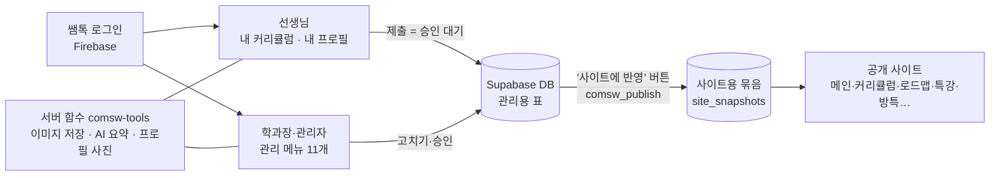
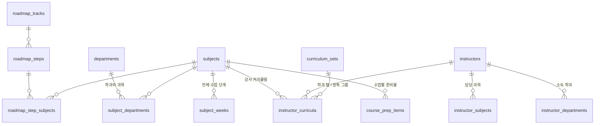
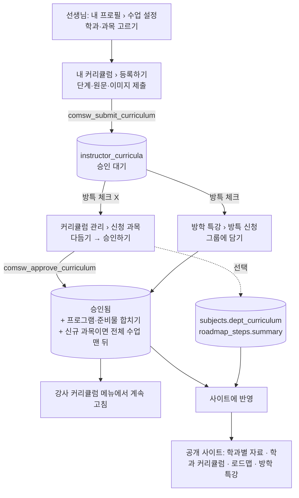
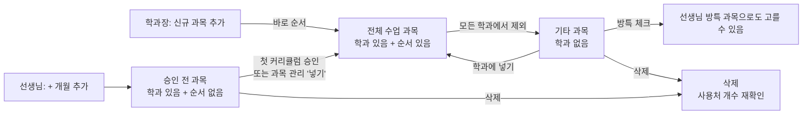

# 컴수원 관리 화면 구조 정리

> 2026-10-27 기준 코드에서 정리했습니다. 구조 변경을 계획하기 전 "지금 모습"을 한눈에 보기 위한 문서입니다.
> 표 이름(`subjects` 등)은 DB 표입니다. 함수 이름(`comsw_…`)은 DB에서 한 번에 처리하는 기능입니다.

## 1. 전체 그림

- **관리 화면에서 고친 내용은 바로 사이트에 나오지 않습니다.** 오른쪽 위 **'사이트에 반영'**을 눌러야 그 순간의 모든 내용이 한 묶음(스냅샷)으로 만들어지고, 공개 사이트는 그 묶음만 읽습니다.
- 그 전에는 메뉴 제목 옆 **미리보기**로만 볼 수 있습니다.
- 로그인은 쌤톡(Firebase) 계정입니다. 역할(관리자 / 학과장 / 선생님)에 따라 보이는 메뉴가 다릅니다.

## 2. 누가 무엇을 하나

| 역할 | 보이는 메뉴 | 주로 하는 일 |
|---|---|---|
| 선생님 | 내 커리큘럼, 내 프로필 | 수업 설정(학과·과목 고르기), 단계별 커리큘럼·이미지 제출, 프로필(경력·한마디·사진) 제출 |
| 학과장 | 관리 메뉴 전부 + 내 커리큘럼·내 프로필 | 선생님 제출물 다듬기·승인, 학과·과목·로드맵 관리, 사이트에 반영 |
| 관리자 | 학과장과 같음 | 학과장과 같음(+ 계정 연결 등) |

## 3. 메뉴별 역할과 구조

메뉴 순서는 실제 화면 순서와 같습니다. "읽기 / 쓰기"는 그 화면이 다루는 주요 표입니다.

### 3-1. 기본 설정
| 탭 | 하는 일 | 주요 표 | 사이트에 나오는 곳 |
|---|---|---|---|
| 메인 화면 | 배경 미디어(이미지·영상 카드), 하단 메뉴(이름·사용·순서), 기타 설정(방학 특강 그룹·배경, 로드맵 로고 등), **AI 설정(지시문·사용량)** | `main_media`, `menus`, `site_settings` | 메인 페이지 |
| 로딩 화면 | 로딩 때 나오는 문구·이미지 | `loading_items` | 로딩 화면 |

### 3-2. 강사 관리
| 탭 | 하는 일 | 주요 표 |
|---|---|---|
| 강사 | 강사 카드(사진·이름·학과·담당 과목·경력·한마디), 사이트 표시, 순서 | `instructors`, `instructor_departments`, `instructor_subjects` |
| 승인 대기 | 선생님이 낸 **프로필** 승인 / 수정 요청 | `instructor_profile_drafts` → `comsw_approve_profile`, `comsw_request_profile_changes` |
| 계정 연결 | 쌤톡 회원 ↔ 강사 정보 연결 | `instructors.account_uid` |

사이트: 학과별 자료의 **강사소개**(`강사페이지` 묶음)

### 3-3. 학과 관리
| 탭 | 하는 일 | 주요 표 / 함수 |
|---|---|---|
| 학과 | 학과 카드(이름·영문·소개·대표 이미지), 카테고리 | `departments`, `site_categories` |
| 학과별 과목 | 학과에 과목 넣기·빼기·순서 | `subject_departments` → `comsw_save_subject_layout` |
| 과목 관리 | 학과별 과목 쓰임새 보기, 정리 필요(승인 전·커리큘럼 없음) 과목 넣기·삭제 | `comsw_subject_usage`, `comsw_activate_subject`, `comsw_delete_subjects` |

### 3-4. 커리큘럼 관리
| 탭 | 하는 일 | 주요 표 / 함수 |
|---|---|---|
| 신청 과목 | 선생님이 낸 **커리큘럼**(승인 대기) 다듬기 → (선택) 학과·로드맵 문구 → 승인하기. 다음 달 과목 추가·이 달 신청 삭제 | `instructor_curricula`(대기) → `comsw_approve_curriculum`, `subjects.dept_curriculum`, `roadmap_steps.summary` |
| 학과 커리큘럼 | 학과를 고르면 과목 표(과목명·기간·학과별 요약·프로그램·준비물·학습 수준), 순서(=전체 수업 순서), 과목 추가·제외, 과목 안 **단계** 편집 | `subjects`, `subject_departments`, `subject_weeks` → `comsw_save_subject_layout` |
| 신규 과목 추가 | 과목명 + 학과로 새 과목(바로 학과 커리큘럼 맨 뒤) | `comsw_create_subject` |
| 기타 과목 | 학과가 없는 과목: 이름·기간·단계, 방특 체크, 작성된 커리큘럼 보기, 학과에 넣기, 삭제 | `subjects`(학과 연결 없음), `comsw_delete_subjects` |

### 3-5. 강사 커리큘럼
- **승인된** 강사 커리큘럼(사이트에 나오는 줄)을 학과 탭·강사·과목으로 검색해 카드로 고칩니다. 방학 특강 줄은 빠집니다.
- 표: `instructor_curricula`(승인), `curriculum_sets`(학과 탭)
- 사이트: 학과별 자료의 강사별 커리큘럼(학과 탭마다 묶음)

### 3-6. 로드맵
- 로드맵 줄(보통 학과) × 단계 상자. 단계마다 과목 고르기, 원문 보기, 요약(사이트 문구).
- 표: `roadmap_tracks`, `roadmap_steps`, `roadmap_step_subjects`
- 사이트: 로드맵 페이지(`로드맵` 묶음)

### 3-7. 수업별 준비물
- 교재 / 준비물 / AI 툴 탭. 학과 → 과목별 카드(이미지·내용·링크·정가·설명).
- 표: `course_prep_items`
- 사이트: 수업별 준비물(`수업별 준비물(AI/교재 등)` 묶음)

### 3-8. 특강·세미나
- 특강 카드(포스터·제목·일정 등), 신청자 명단.
- 표: `seminars`, `seminar_applications`
- 사이트: 특강/세미나 페이지(신청 가능)

### 3-9. 방학 특강
- 그룹(예: 2026년 여름방학특강) 고르기·추가. 선생님이 '방특'으로 낸 커리큘럼을 **방특 신청**에서 그룹에 담기(=승인). 그룹 강의 목록 직접 고치기.
- 표: `curriculum_sets`(`is_vacation`), `instructor_curricula`(`vacation`) → `comsw_approve_curriculum`
- 사이트: 방학 특강 페이지(사이트에 나올 그룹은 기본 설정 › 메인 화면 › 기타 설정에서 고름)

### 3-10. 채용 공고
- 학과를 고르면 그 학과 채용 공고 목록.
- 표: `recruitment_posts`
- 사이트: 학과별 자료의 채용 공고

### 3-11. 내 커리큘럼 (선생님, 학과장도 씀)
| 탭 | 하는 일 |
|---|---|
| 등록하기 | 내 학과 · 선택 학과(학과 탭) · 방특 체크 → 과목 탭마다 단계(원문·이미지)와 프로그램·준비물 → '승인 요청하기'. '+ 개월 추가'(다음 달 과목). 학과장은 다른 선생님 **대신 등록** 가능 |
| 조회하기 | 내가 낸 줄(승인 대기 / 승인됨 · 방특) 보기·고쳐서 다시 요청 |

- 함수: `comsw_submit_curriculum`(한 번에 제출, 실패하면 아무것도 안 남음)
- 고를 수 있는 과목 = 수업 설정에서 고른 학과 과목 (+ 방특 체크 시 방특 과목)

### 3-12. 내 프로필 (선생님)
| 탭 | 하는 일 |
|---|---|
| 내 소개 | 경력·한마디·본인 사진 제출(승인 대기) → 학과장이 AI로 프로필 사진 생성·승인 |
| 수업 설정 | 내 학과(쌤톡 학과)·학과마다 수업하는 과목 체크, 학과장은 **메인 학과** |

- 함수: `comsw_save_my_profile`, `comsw_set_my_classes`, `comsw_set_my_main_department`

## 4. 핵심 데이터

| 표 | 무엇 | 비고 |
|---|---|---|
| `subjects` | 과목 | `sort_order` 있음 = 전체 수업에 나옴(학과 있음), 없음 = 승인 전 신규 또는 기타 과목. `dept_curriculum` = 학과별 커리큘럼 요약, `is_vacation` = 방특 과목 |
| `subject_departments` | 과목 ↔ 학과 | 마지막 학과에서 빠지면 자동으로 기타 과목(순서 지움) |
| `subject_weeks` | 과목 안의 단계 | 사이트 '전체 수업'에서 과목을 펼치면 나옴 |
| `instructor_curricula` | 강사별 커리큘럼 한 줄(단계) | `status` = pending(승인 대기)/approved, `vacation` = 방특, `set_id` = 학과 탭 또는 방특 그룹, `written` = 원문, `summary` = 사이트 문구 |
| `curriculum_sets` | 학과 탭(강사 커리큘럼 묶음) / 방특 그룹 | |
| `instructors` (+ `_departments`, `_subjects`) | 강사 | `account_uid` = 쌤톡 계정, `main_department_id` = 학과장 메인 학과 |
| `roadmap_*` | 로드맵 줄·단계·단계의 과목 | 한 단계에 과목 둘 → 문구도 줄마다 과목 하나 |
| `site_snapshots` | '사이트에 반영' 때 만든 묶음 | 공개 사이트는 가장 최근 것만 읽음 |

## 5. 데이터 흐름

### 5-1. 선생님 커리큘럼 → 사이트

### 5-2. 과목의 일생

### 5-3. 프로필 → 사이트
선생님 내 소개 제출(`instructor_profile_drafts`) → 강사 관리 › 승인 대기(AI 프로필 사진 생성 · 승인 또는 수정 요청) → `instructors` → 사이트에 반영 → 강사소개

### 5-4. 이미지
화면에서 고르기 → 브라우저가 줄이고 WebP로 바꿈(커리큘럼 2560px, 일반 1920px) → 서버 함수 `comsw-tools`가 Firebase 저장소에 올림(`media_assets` 기록) → 주소를 각 표에 저장. 커리큘럼 썸네일 영역은 주소 끝 `#crop=…`(비율).

## 6. 공개 사이트 페이지 ← 사이트용 묶음 ← 관리 메뉴

| 사이트 페이지 | 읽는 묶음 | 고치는 관리 메뉴 |
|---|---|---|
| 메인 (`index.html`) | 메인 페이지, 로딩 중, 수업별 준비물, 방특 | 기본 설정, 수업별 준비물, 방학 특강 |
| 전체 수업·학과별 자료 (`Curriculum_full.html`) | 컴수원_전체수업, 강사페이지, 학과 탭별 강사 커리큘럼, 학과별 채용 | 학과 커리큘럼(순서·단계), 강사 관리, 강사 커리큘럼·신청 과목, 채용 공고 |
| 학과 커리큘럼 (`Curriculum_onepage.html`) | 컴수원_전체수업, 로드맵 | 학과 커리큘럼, 신청 과목(학과 문구), 로드맵 |
| 로드맵 (`roadmap.html`) | 로드맵, 컴수원_전체수업 | 로드맵, 신청 과목(로드맵 문구) |
| 수업별 준비물 (`item.html`) | 수업별 준비물 | 수업별 준비물 |
| 특강/세미나 (`seminar.html`) | 특강 및 세미나 | 특강·세미나 |
| 방학 특강 (`vacation.html`) | 방특 그룹 강사 커리큘럼 | 방학 특강, 기본 설정(그룹·배경) |

(각 페이지마다 태블릿용 `_tablet.html`이 따로 있습니다.)

## 7. 지금 구조에서 겹치거나 헷갈리는 곳 (구조 변경 검토용)

1. **과목을 다루는 곳이 여섯 군데**: 학과 관리(학과별 과목·과목 관리), 커리큘럼 관리(학과 커리큘럼·신규 과목 추가·기타 과목), 그리고 로드맵·수업별 준비물에서도 과목을 고릅니다.
2. **과목을 학과에 넣는 곳이 셋**: 학과 관리 › 학과별 과목, 커리큘럼 관리 › 학과 커리큘럼('+ 과목 추가'), 기타 과목('학과에 넣기'). 순서를 바꾸는 곳도 둘(학과별 과목, 학과 커리큘럼)이고 같은 순서를 씁니다.
3. **강사 커리큘럼을 보는 곳이 넷**: 신청 과목(대기), 강사 커리큘럼(승인), 방학 특강(방특), 기타 과목 '커리큘럼'(보기).
4. **승인하는 곳이 셋**: 신청 과목(커리큘럼), 방학 특강(방특 커리큘럼), 강사 관리 › 승인 대기(프로필).
5. **메뉴 이름과 하는 일이 다른 곳**: '커리큘럼 관리' 안에 과목 만들기·기타 과목이 있고, '학과 관리' 안에 과목 관리가 있음. '기본 설정 › 메인 화면' 안에 AI 설정이 있음.
6. **사이트에 보이는 문구가 여러 층**: 단계 문구(강사 커리큘럼 `summary`), 학과별 커리큘럼 요약(`subjects.dept_curriculum`), 로드맵 문구(`roadmap_steps.summary`), 전체 수업 단계(`subject_weeks`) — 서로 다른 곳에서 고칩니다.
7. **선생님 쪽 시작점이 둘로 나뉨**: 과목을 고르는 곳은 내 프로필 › 수업 설정, 쓰는 곳은 내 커리큘럼.
